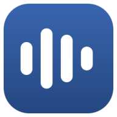
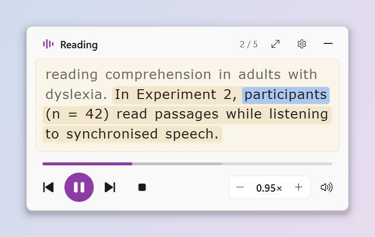
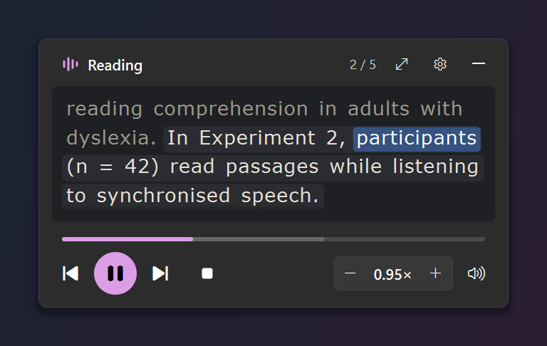
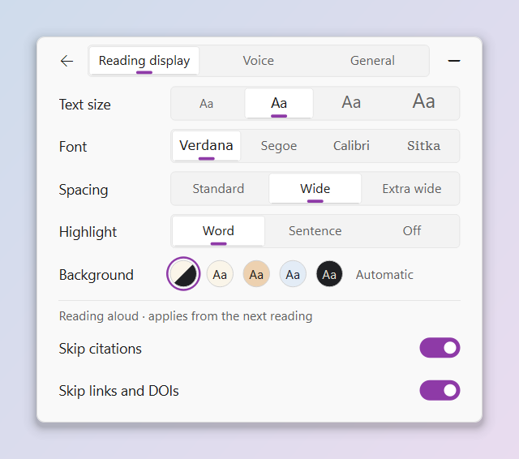
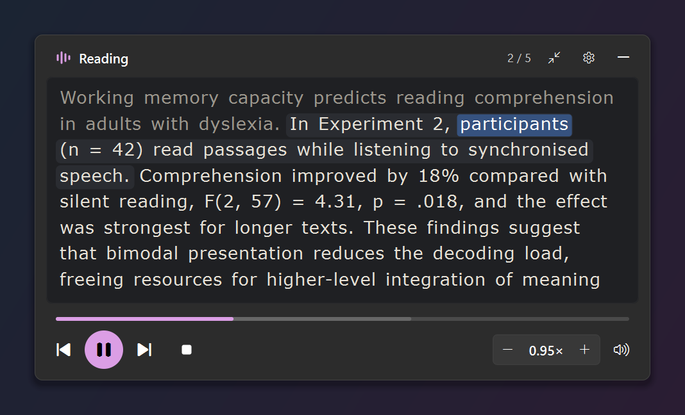

<p align="center">
  
</p>

<h1 align="center">Saylight</h1>

<p align="center"><b>Highlight it, and it says it.</b></p>

Highlight text anywhere on Windows, press <kbd>Ctrl</kbd> + <kbd>`</kbd>, and Saylight reads it in a natural voice
while each word lights up as it's spoken.

Saylight is built for dyslexic readers, especially anyone working through dense academic papers. It stays out of
the way until you need it, follows along with the voice so you never lose your place, and cleans up the mess that
text copied from PDFs usually brings with it.

<p align="center">
  
  
</p>

## Features

**One shortcut for everything.** Highlight text and press <kbd>Ctrl</kbd> + <kbd>`</kbd> to start reading. Press it
with nothing highlighted to show or hide the panel, or to pause and resume while it's reading.

**Type or paste your own text.** Click ✎ or the empty reading box, type or paste, then press **Read aloud**
(<kbd>Ctrl</kbd> + <kbd>Enter</kbd>). Highlight part of it and <kbd>Ctrl</kbd> + <kbd>`</kbd> reads just that part.
The box uses your reading font, size and background, so what you type looks like what you'll hear.

**Open documents.** Drop a PDF, Word, text or Markdown file on the panel, choose **Open a file**, or use
**Open with** in File Explorer. Citations stay on screen, dimmed, and aren't read aloud. Footnotes, captions and
tables move to a dimmed *Notes* section after the main text, and the reference list stays dimmed at the end, so
reading stops where the paper does. One click on *Read the notes too* or *Read the references too* reads them
for that file.

**Read from screen** (<kbd>Ctrl</kbd> + <kbd>Alt</kbd> + <kbd>`</kbd> or the ⬚ button): drag over any text, even in a
picture or a scanned PDF, and Saylight reads it aloud and marks each word where it is. It uses the text
recognition built into Windows, so it works offline and nothing leaves your PC to find the text.

**Scanned PDFs.** A PDF that's only pictures of pages is read the same way, page by page, with a page count and
the time left while it works. For a long scan Saylight asks first: the first 50 pages, all of them, or the pages
you choose. If a scan's resolution is low, the panel says some words may be wrong.

**Reading ruler.** A clear band follows your pointer and dims the rest of the screen, so the line you're on
stands out. Turn it on in Reading display or the tray, and pick its height and how much it dims.

**Pronunciations.** Right-click a word to change how it's said, and hear the sentence with the new pronunciation
before you save it. Your list works with every voice, and you can import or export it.

**Save as audio** (in the ⋯ menu or the tray) makes an MP3 you can listen to anywhere: the whole document, or
from the page you're on.

**Pick up where you left off** (off by default) remembers your place in each file, never its text. Open the
file again and Saylight carries on from there.

**Follow along as you listen.**
- A soft band marks the sentence being read, and a highlight follows the current word.
- Earlier sentences are dimmed slightly. Text you haven't reached is never dimmed, so you can read ahead of the voice.
- Scroll back to re-read anything; a *Back to current* button returns you to the voice.
- Click any sentence to read from there.

**Made for academic text.**
- Words split across PDF line breaks are rejoined ("compre- hension" becomes "comprehension").
- Ligatures (fi, fl), page headers and manuscript line numbers are cleaned up.
- Citations such as *(Smith et al., 2019)* and *[12]* are skipped but stay on screen, dimmed, and web links are
  read as "link". Point at dimmed text to see why it isn't read.
- Abbreviations are read in full: *Fig.* as "figure", *e.g.* as "for example", *pp.* as "pages".
- Sentence splitting understands *et al.*, *e.g.*, *Fig. 3*, decimals and statistics, so the highlight stays accurate.

**Reading display you can tune.** Choose the text size, font (Verdana, Segoe UI, Calibri or Sitka), letter and line
spacing, highlight style, and background (Cream, Peach, Soft blue, Soft dark, or automatic with your Windows theme).

**Pick the voice you like.** Ava is the default, and the Voice page lists Microsoft's other English voices, grouped
by accent (US, UK, Australian, Canadian, Irish, Indian, New Zealand and South African). Press ▶ next to any of them
to hear a short sample sentence first. **Show all languages** loads the full list of voices in every language.
A few voices don't report word timing; they're marked *sentence highlight only*, and only the sentence is
highlighted while they read. Windows' own voices (David, Mark and Zira on most PCs, plus any you've added) are
listed after the online ones. They work offline and your text stays on your PC, but they sound more robotic.

<p align="center">
  
  
</p>

**Simple controls.**
- Play and pause, previous and next sentence, and stop.
- **Clear** empties the reading box and anything you typed; Undo appears for 10 seconds.
- Speed from 0.5× to 2×; changes apply from the next sentence without distorting the voice.
- Volume control, and a larger reading view when you want more context.

**Unobtrusive by design.**
- The panel floats on top but never takes keyboard focus, so the app you're reading in stays active. Only the Type
  or paste box, and the small windows for Pronunciations, Save as audio, a PDF password and choosing pages, take
  the keyboard, only while they're open; they hand it back when you're done or press <kbd>Esc</kbd>.
- Opening a file never pops the panel up or takes the keyboard. If the panel is hidden, the status pill says how
  it's going.
- A tray icon and a small status pill show what's happening while the panel is hidden.
- Follows Windows dark and light mode, high-contrast themes, text scaling and the *Animation effects* setting.
- When a new version is out, one quiet line in the panel says so, with **Install** and **Not now**. No pop-ups.

## Design choices

The reading display follows published guidance and research on dyslexia and reading, rather than guesswork:

| Choice | Why |
|---|---|
| Verdana at 18 px with 1.5 line spacing | Larger sizes help dyslexic readers ([Rello et al., 2013](https://doi.org/10.1145/2461121.2461125)). Verdana keeps I, l and 1 distinct, and it's on the [British Dyslexia Association](https://www.bdadyslexia.org.uk/advice/employers/creating-a-dyslexia-friendly-workplace/dyslexia-friendly-style-guide) recommended list. |
| Slightly wider letter *and* word spacing | Extra letter spacing helps some dyslexic readers ([Zorzi et al., 2012](https://pmc.ncbi.nlm.nih.gov/articles/PMC3396504)), but only when word spacing grows with it ([Galliussi et al., 2020](https://pmc.ncbi.nlm.nih.gov/articles/PMC7188700/)). |
| No "dyslexia font" by default | Specialist fonts show no benefit in controlled studies ([Wery & Diliberto, 2017](https://pmc.ncbi.nlm.nih.gov/articles/PMC5629233/); [Kuster et al., 2018](https://pmc.ncbi.nlm.nih.gov/articles/PMC5934461/)). |
| Text and audio together, with read-ahead | Dyslexic students read faster with synchronised text-to-speech, with no loss in comprehension ([Schneps et al., 2019](https://doi.org/10.1111/mbe.12180)). |
| Cream and warm backgrounds, never pure black on white | The BDA style guide recommends cream or pastel backgrounds, and warm backgrounds tested fastest in [Rello & Bigham (2017)](https://doi.org/10.1145/3132525.3132546). They're offered as comfort settings, not as a treatment. |
| Skipping citations | Mid-sentence citations separate the subject from its verb, which is hard to follow by ear. Skipped citations can be switched back on at any time. |

Every reading background keeps text contrast between 11:1 and 15:1 (WCAG AAA).

## Install

1. Download **Saylight-Setup.exe** from the [latest release](../../releases/latest).
2. Run it. Setup installs Saylight just for you, so it doesn't need administrator rights, and it doesn't need
   Python or anything else.
3. Leave *Start Saylight when I sign in* ticked if you want it ready whenever you highlight text.

Saylight works on Windows 10 and 11. It goes into `%LOCALAPPDATA%\Programs\Saylight` and appears in the Start
menu. To remove it, open **Settings → Apps → Installed apps**, find Saylight and choose **Uninstall**. It asks
whether to remove your settings too. Setup adds Saylight to **Open with** for PDF, Word, text and Markdown files
without making it the default for any of them. If a kind of file had no default app chosen, Windows may ask
which app to use the next time you open one.

**The Python version.** Each release also has **Saylight-Python.zip**, the same app run by Python instead of
packaged as an .exe. Use it if Smart App Control is on (see below), or if you'd rather run it through Python.
Unzip it and double-click *Install Saylight.cmd*. It needs Python 3.10 or newer, and it explains how to get
Python if it's missing.

**Upgrading from 1.0 or 1.1** (the zip with *Install Saylight.cmd*): run Saylight-Setup.exe, or the new
Saylight-Python.zip if Smart App Control is on. Either one closes the running copy, replaces it and keeps your
settings.

### If Windows blocks Saylight

Saylight isn't code-signed, so Windows may be cautious the first time you run it.

- **"Windows protected your PC"** (SmartScreen): choose **More info**, then **Run anyway**.
- **Smart App Control** (Windows 11) blocks apps it doesn't recognise, and it can't make an exception for just
  one app. To check whether it's on, open **Windows Security → App & browser control → Smart App Control
  settings**. If it is, use **Saylight-Python.zip** instead. It runs through Python, which Windows already trusts,
  and it works the same way.

### Checking the download

Each release has a `Saylight-Setup.exe.sha256` file next to the installer, holding its SHA-256 checksum. To check
your copy, open PowerShell in the folder you downloaded it to and run:

```
Get-FileHash .\Saylight-Setup.exe -Algorithm SHA256
```

The long number it prints should match the one in the `.sha256` file. If it doesn't, delete the download and get
it again from the release page.

### Updates

Once a day, Saylight asks GitHub whether there's a newer release. The request carries no IDs or cookies, and it
never happens while Saylight is reading. When there is one, a line in the panel offers **Install**: Saylight
downloads Setup, checks its size and SHA-256, runs it, and opens again on the new version. **Not now** hides the
line until the next version (the tray menu still offers it).

On the Python version, or when Smart App Control is on, the line offers **Get it** instead. That opens the
release page, so you can download the new version yourself. Saylight never swaps itself for a copy Windows
might refuse to start.

To stop the daily check, open ⋯ **More → Settings → General** and choose **Turn off** next to *Saylight checks
GitHub for updates once a day*. **Check for updates** on the same page still works whenever you click it.

### Running from source

```
python -m pip install --user -r requirements.txt
python saylight_app.py --install
```

`requirements.txt` pins the exact versions the release is built and tested with, on Python 3.14.
Saylight-Python.zip uses looser versions that suit Python 3.10 or newer.

| Command | What it does |
|---|---|
| `python saylight_app.py --install` | Start with Windows, add a Start menu entry, and start now |
| `python saylight_app.py --uninstall` | Undo `--install` and quit |
| `python saylight_app.py --start` / `--quit` | Start or quit the running copy |
| `python saylight_app.py <file>` | Open a PDF, Word, text or Markdown file (in the running copy, if there is one) |

## Using it

| Action | How |
|---|---|
| Read highlighted text | <kbd>Ctrl</kbd> + <kbd>`</kbd> (the key left of <kbd>1</kbd>), or the ▶ button |
| Read from the screen | <kbd>Ctrl</kbd> + <kbd>Alt</kbd> + <kbd>`</kbd>, the ⬚ button, or *Read from screen…* in the tray. Drag over the text; <kbd>Esc</kbd> or a right-click cancels |
| Reading ruler | ⋯ **More → Settings → Reading display**, or *Reading ruler* in the tray. An optional shortcut is in **Settings → General** |
| Pause / resume | <kbd>Ctrl</kbd> + <kbd>`</kbd> with nothing highlighted, the ▶ button, or middle-click the tray icon |
| Show / hide the panel | <kbd>Ctrl</kbd> + <kbd>`</kbd> with nothing highlighted (when not reading), or click the tray icon |
| Jump to a sentence | Click it, or use the progress bar |
| Re-read | Scroll over the text, or press ⏮ to replay the sentence |
| Open a file | Drop it on the panel, ⋯ **More → Open a file…**, or right-click it in File Explorer and choose **Open with → Saylight** |
| Read the notes or references | The *Read the notes too* and *Read the references too* buttons after the main text |
| Change how a word is said | Right-click it in the panel, or ⋯ **More → Pronunciations…** |
| Save as audio | ⋯ **More → Save as audio…**, or the tray menu |
| Text size | <kbd>Ctrl</kbd> + scroll over the text, or ⋯ **More → Settings → Reading display** |
| Choose a voice, what's read aloud | ⋯ **More → Settings → Voice**. Click a voice to use it, or ▶ to hear a sample first |
| Start with Windows, updates, picking up where you left off | ⋯ **More → Settings → General** |
| Speed | − / + buttons, or scroll over the speed control |
| Media keys | Play/Pause, Next and Previous work while it's reading |
| Read your own text | Click ✎ or the empty reading box, type or paste, then <kbd>Ctrl</kbd> + <kbd>Enter</kbd> or **Read aloud**. Highlight part of it to hear just that part. <kbd>Esc</kbd> goes back and keeps your text |
| Clear the text | The eraser button, or *Clear text* in the tray menu. **Undo** appears for 10 seconds |

## Notes

- On UK and European keyboards <kbd>Ctrl</kbd> + <kbd>Alt</kbd> + <kbd>`</kbd> is <kbd>AltGr</kbd> + <kbd>`</kbd>;
  switch it off in **Settings → General** if you type ¦. The ⬚ button and the tray menu always work.
- If Saylight says it needs a language pack to find text, add **English (United States)** in Windows' language
  settings (the notice has a button that opens them), then press **Try again**.

## Privacy

The default voices are Microsoft's online neural voices (the same voices as Microsoft Edge's Read Aloud), accessed
through the open-source [edge-tts](https://github.com/rany2/edge-tts) library. That means **the text you have read
aloud is sent to Microsoft** to be turned into speech, so avoid using them on confidential material. Windows' own
voices, listed after the online ones, run on your PC and send nothing. A voice preview sends only its fixed sample
sentence, never your text.

Read from screen and scanned PDFs work on your PC: the picture of the screen or page stays in memory and is
dropped as soon as the text is found. Nothing is saved.

Saylight itself stores no text and no audio. Text is kept in memory only while you're reading, and the audio
plays from short-lived files in a temporary folder that Saylight empties as it goes and deletes when it quits.
Text you type or paste stays in memory until you clear it or quit Saylight, and is sent to Microsoft only when
you have it read aloud. Opening a document works the same way: its text is read into memory and never saved.

There are three exceptions, and each is something you choose:
- **Save as audio** writes an audio file, only to the place you pick. If you cancel, or the save fails, the
  unfinished file is deleted.
- **Pronunciations** keeps the words you add, and what to say for them.
- **Pick up where you left off**, when you switch it on, keeps each file's location and your place in it, never
  its text. Turning it off deletes that list at once.

A PDF password is used once, to open the file, and is never stored or logged. Windows itself adds files you open
or save through Saylight's Open and Save dialogs to its Recent list, as it does for other apps.

Saylight goes online for only these things:
- speaking, saving audio with an online voice, and voice previews (Microsoft);
- the full voice list, only when you switch on **Show all languages** (Microsoft);
- the daily update check, which you can turn off, and the download when you click **Install** (GitHub).

Everything Saylight saves is in `%LOCALAPPDATA%\Saylight`: your settings, a log, and the pronunciation list and
saved places if you use them. The log records counts and error types only, never text, file names or window
titles. Uninstalling asks whether to delete your settings.

## Development

```
saylight_app.py          entry point, command-line options and the start-up crash message
saylight/
  academic_text.py       cleans copied text and splits sentences
  alignment.py           maps what's spoken back to what's shown (dimmed citations, "figure" for Fig.)
  text_model.py          sentences, synthesis chunks and word timing
  documents/             reading PDF, Word, text and Markdown files
  pronunciations.py      the pronunciation list
  export.py              Save as audio
  resume.py              Pick up where you left off
  single_instance.py     Open with: hands a file to the running copy
  engine.py              the reading state machine
  voices/                the voice interface, the online voices (edge-tts), Windows' voices, the list and previews
  audio_cache.py         the temporary folder for audio chunks
  player.py              playback (Windows MCI)
  input_thread.py        global shortcuts and copying the selection
  ocr/, winrt_support.py text recognition with Windows OCR (the only place that loads the WinRT bindings)
  screen_reader.py       Read from screen: the selection, the capture and the reading
  screen_capture.py      grabbing an area of the screen, in memory only
  settings.py, theme.py  saved settings, colours and fonts
  paths.py               where Saylight keeps its data
  updates.py             the update check, download and checksum
  update_service.py      when to check, and Install
  ui/                    the panel, its ⋯ menu, settings tabs, controls, reading view, tray, status pill and tooltips
  ui/compose.py          the Type or paste box
  ui/sheet.py            the windows that take the keyboard: Pronunciations, Save as audio, the PDF password
  ui/region_overlay.py   the selection overlay; ui/screen_highlight.py marks the words on the screen
  ui/reading_ruler.py    the reading ruler
packaging/               the PyInstaller spec, the installer script, the licence gate and the build tests
scripts/build_release.py builds dist/Saylight-Setup.exe and its .sha256 file
```

Run the test suite (about 1,850 tests) from the project folder:

```
python -m unittest discover -s saylight/tests -t .
```

To build the installer you also need the tools in `requirements-build.txt` and Inno Setup 6.7.3. Then
`python scripts/build_release.py` builds the app, checks every bundled licence, runs the frozen self-test and the
installer lifecycle test on a separately named test install, and writes `dist\Saylight-Setup.exe` with its
checksum. [THIRD_PARTY_NOTICES.md](THIRD_PARTY_NOTICES.md) lists what's inside.

## Acknowledgements

- [edge-tts](https://github.com/rany2/edge-tts) for access to the neural voices (LGPL-3.0)
- [Qt for Python (PySide6)](https://doc.qt.io/qtforpython-6/) for the interface (LGPL-3.0)
- [pypdf](https://github.com/py-pdf/pypdf) for reading PDFs (BSD-3-Clause)
- [pywinrt](https://github.com/pywinrt/pywinrt) for Windows' text recognition, PDF rendering and voices (MIT)
- [PyInstaller](https://pyinstaller.org/) and [Inno Setup](https://jrsoftware.org/isinfo.php) for the Windows app
  and its installer
- Segoe Fluent Icons and Segoe UI Variable, which ship with Windows 11, and the OCR and voices built into Windows

Saylight is an independent project and is not affiliated with Microsoft.

## License

[MIT](LICENSE) © 2026 Cole Craven
